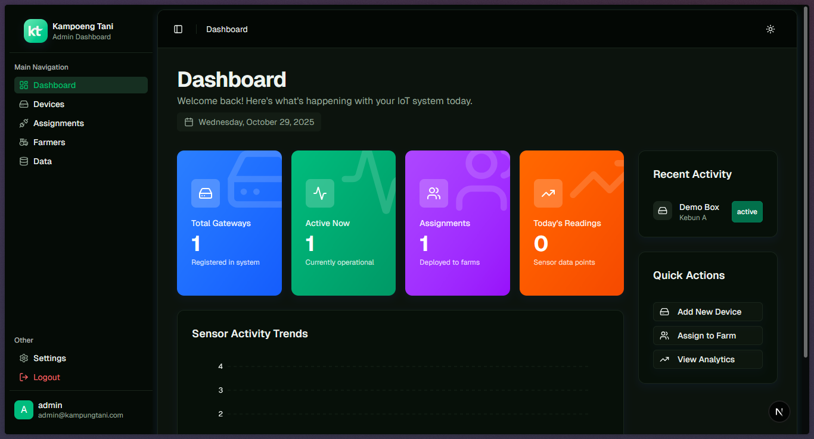
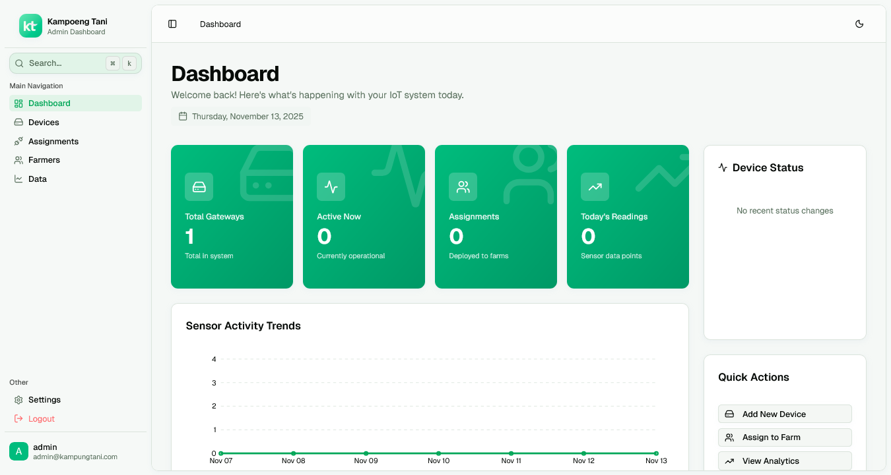

## Showcase

<div align="center">
  
  <p><em>Modern Dark Mode Interface</em></p>
  
  <p><em>Clean Light Mode Interface</em></p>
</div>

**INTERNAL USE ONLY - PT Kampoeng Tani**

A comprehensive IoT monitoring dashboard for agricultural sensor data management and gateway monitoring, built with modern web technologies and real-time MQTT integration.

## Table of Contents

- [About The Project](#about-the-project)
- [Features](#features)
- [Technology Stack](#technology-stack)
- [Getting Started](#getting-started)
  - [Prerequisites](#prerequisites)
  - [Installation (Docker)](#installation-docker)
  - [Local Development](#local-development)
- [Environment Configuration](#environment-configuration)
- [Usage](#usage)
- [API Documentation](#api-documentation)
- [Contact](#contact)

## About The Project

Kampung Tani IoT Monitoring Dashboard is a proprietary agricultural monitoring system developed for PT Kampoeng Tani. It enables real-time tracking and management of IoT sensors in farming environments, providing farmers and agricultural professionals with intuitive tools to monitor soil conditions, environmental parameters, and gateway status through a modern web interface.

### Key Capabilities

- **Real-time IoT Data Monitoring**: Live sensor data from agricultural IoT gateways (SEM225, NPK sensors, weather stations)
- **Gateway Management**: Automatic gateway registration, status monitoring, and maintenance tracking
- **Farmer & Farm Management**: Complete management system for farmers and their farm assignments
- **Data Visualization**: Interactive charts and dashboards for sensor data analysis
- **MQTT Integration**: Real-time data streaming from IoT gateways via MQTT protocol
- **User Authentication**: Secure access control with JWT-based authentication
- **RESTful API**: Comprehensive API for data access and gateway management
- **Shareable Reports**: Publicly accessible, token-based summary reports for external stakeholders

## Features

### 🌱 Agricultural IoT Monitoring

- Real-time soil sensor data (Temperature, Moisture, pH, NPK levels)
- Environmental monitoring (Humidity, TDS, Salinity, Conductivity)
- Automatic sensor data scaling and unit conversion
- Gateway status tracking and health monitoring

### 📊 Dashboard & Analytics

- Interactive sensor data visualization
- Historical data analysis and trends
- Gateway management and monitoring panels
- Real-time status indicators and aggregated dashboard data
- PDF Report Generation
- Shareable Summary Links (Token-based)

### 🔧 Gateway Management

- Automatic gateway registration via MQTT
- Gateway status history tracking
- Online/offline status monitoring
- Gateway maintenance scheduling
- Gateway assignment to farms and farmers

### 👨‍🌾 Farmer & Farm Management

- Complete farmer profile management
- Farm registration and management
- Farm-to-farmer assignment tracking
- Gateway assignment to specific farms
- Farmer location and contact information management

## Technology Stack

### Frontend

- **Next.js 15+** - React framework
- **React 19** - UI library
- **TypeScript** - Type-safe development
- **Tailwind CSS 4** - Styling
- **TanStack Query** - Data fetching & caching
- **Lucide React** - Icons
- **Recharts** - Data visualization
- **MapLibre GL** - Interactive maps

### Backend & Ingestion

- **FastAPI** - Python web framework
- **PostgreSQL** - Database
- **SQLAlchemy** - ORM
- **Alembic** - Database migrations
- **Paho MQTT** - IoT communication
- **Docker** - Containerization

## Getting Started

### Prerequisites

- Docker & Docker Compose
- Git
- Node.js & pnpm (for local dev)
- Python 3.11+ (for local dev)

### Installation (Docker)

1. **Clone the repository**

   ```bash
   git clone <repository-url>
   cd kampung-tani
   ```

2. **Environment Setup**
   Copy the example environment files:

   ```bash
   cp .env.example .env
   cp backend/.env.local.example backend/.env.local
   cp ingestion/.env.local.example ingestion/.env.local
   cp frontend/.env.local.example frontend/.env.local
   ```

3. **Configure Environment Variables**
   Protect sensitive credentials in `.env` files. Ensure `MQTT_BROKER` is correctly set for your environment.

4. **Start Application**

   ```bash
   docker-compose up --build -d
   ```

5. **Access Application**
   - Frontend: http://localhost:3001
   - Backend API: http://localhost:5000
   - API Docs: http://localhost:5000/api/docs

### Local Development

1. **Backend**

   ```bash
   cd backend
   python -m venv venv
   source venv/bin/activate  # or venv\Scripts\activate
   pip install -r requirements.txt
   python main.py
   ```

2. **Ingestion Service**

   ```bash
   cd ingestion
   python -m venv venv
   source venv/bin/activate
   pip install -r requirements.txt
   python -m app.main
   ```

3. **Frontend**
   ```bash
   cd frontend
   pnpm install
   pnpm dev
   ```

## Contact

**Thoriq Kusuma** - t.paramaditya@gmail.com

---

_This is a private repository. All rights reserved._
